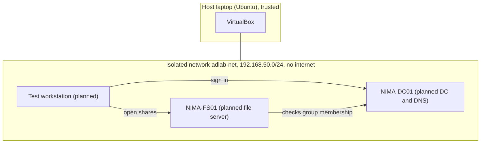

# Lab Architecture

## Threat boundaries
| Boundary | Risk | Control |
|---|---|---|
| Host and VM network | Lab traffic leaking out | Internal Network only, no NAT or bridged adapter |
| Staff and privileged accounts | Everyday account with admin rights | Separate OU and separate accounts |
| Users and shares | Over-broad access | Group-based access, least privilege |
