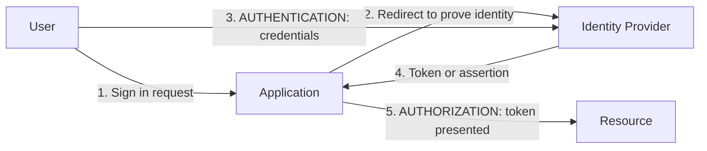
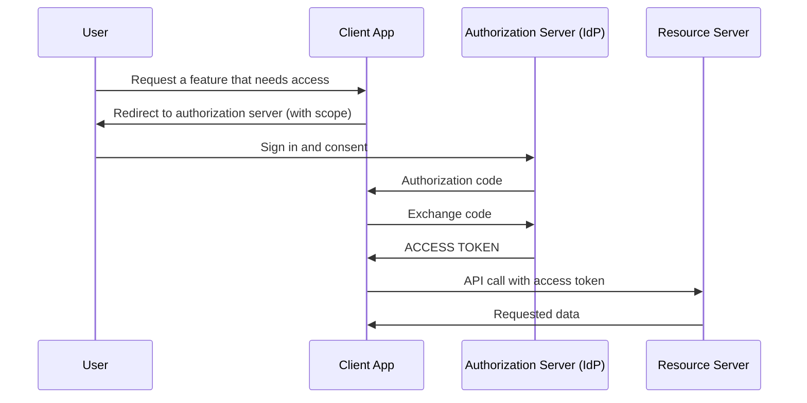
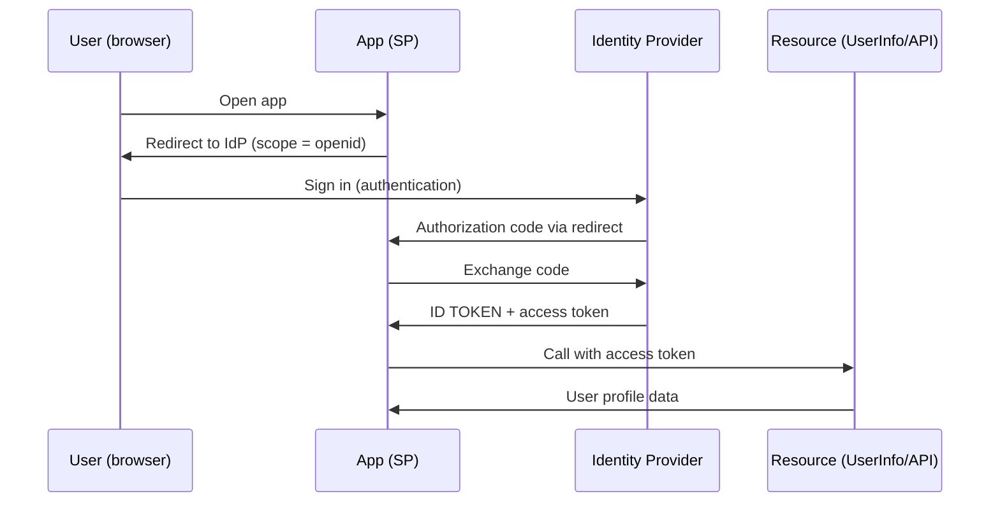
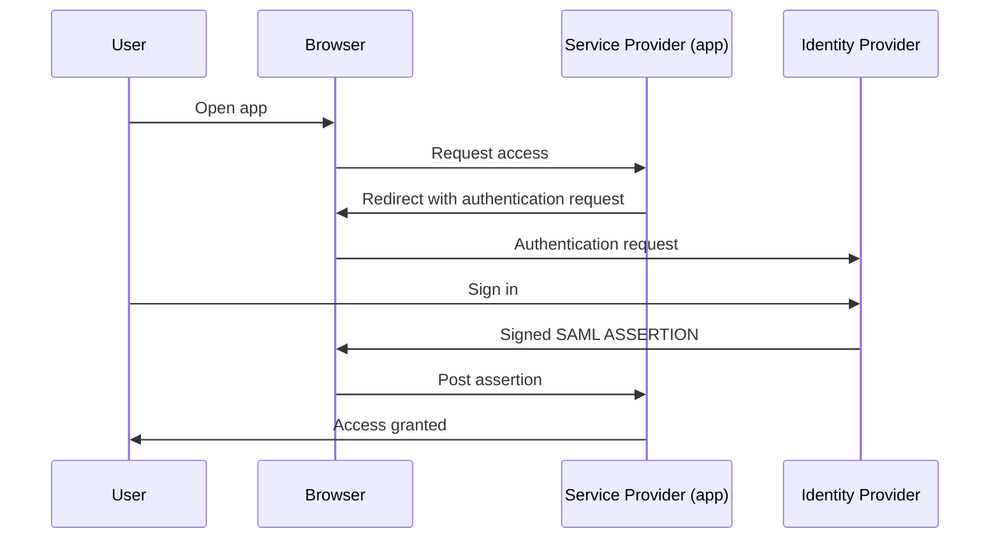
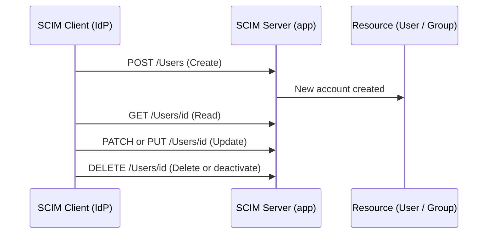

# Protocol Flows

How identity protocols move information between the user, the identity provider (IdP), the application (service provider) and the resource, using National Identity Management Agency (NIMA) as the example.

## Overview: four boxes
Authentication proves who the user is. Authorization decides what they can reach.

## OAuth 2.0 (authorization: delegated access)
Purpose: lets an app access a resource on a user's behalf without seeing their password.

## OIDC (authentication on top of OAuth 2.0)
Purpose: tells the app who the user is. It adds an ID token to the OAuth flow.

## SAML (single sign-on with assertions)
Purpose: lets a user sign in once at the IdP and be trusted by the SP through a signed assertion passed via the browser.

## SCIM (provisioning: managing the account lifecycle)
Purpose: automatically creates, updates and removes user accounts in apps. It handles accounts, not logins.

## How this supports the lab
NIMA's directory will hold the identities. SAML, OIDC and OAuth control how those identities reach apps, and SCIM keeps accounts in step as people join, change roles and leave.
